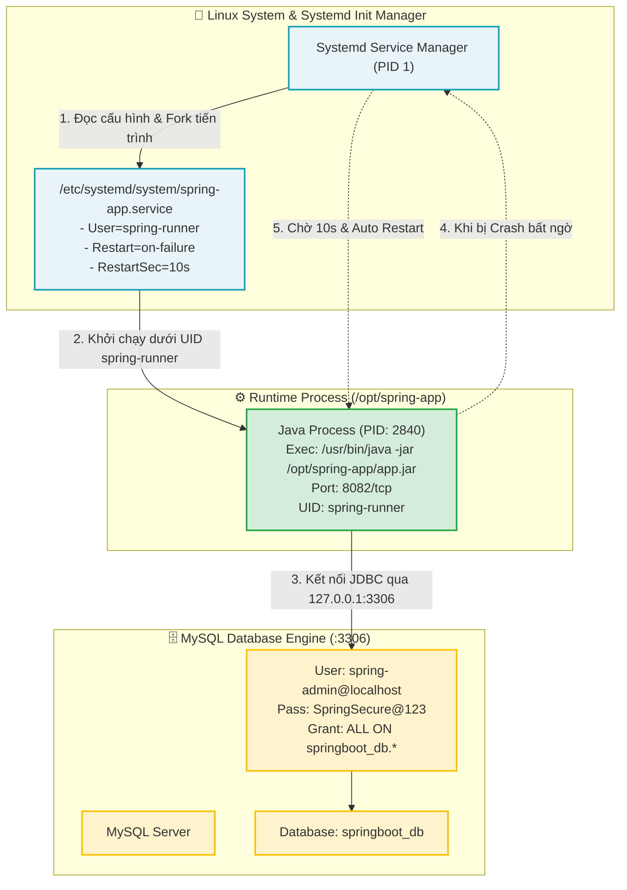

# Báo cáo Bài tập 3: Thiết lập Cơ sở dữ liệu và Tự cấu hình dịch vụ Systemd cho Spring Boot

- **Họ và tên:** Phạm Thanh Phong
- **Mã sinh viên:** N24DTCN120
- **Môn học:** IT209 
- **Session:** 07 

---

## 1. Bối cảnh & Mục tiêu bài tập

Trong quy trình triển khai ứng dụng Web Backend (Spring Boot) trên môi trường Production (Linux VPS):
1. **Quản trị Cơ sở dữ liệu MySQL bảo mật:**
   - Không sử dụng tài khoản `root` cho ứng dụng kết nối dữ liệu.
   - Khởi tạo Database chuyên biệt `springboot_db` và tài khoản người dùng `spring-admin` với mật khẩu mạnh `SpringSecure@123`.
   - Cấp quyền giới hạn phạm vi thao tác trong `springboot_db.*`.
2. **Quản trị tiến trình an toàn bằng Non-root User:**
   - Tạo tài khoản hệ thống `spring-runner` không có quyền đăng nhập shell (`/usr/sbin/nologin`) nhằm triệt tiêu nguy cơ chiếm quyền điều khiển hệ điều hành khi ứng dụng bị tấn công.
3. **Tự thiết kế tệp tin dịch vụ Systemd (`spring-app.service`):**
   - Đảm bảo ứng dụng khởi động tự động cùng hệ điều hành, vận hành chạy nền ổn định (Daemon).
   - Thiết lập chính sách phục hồi tự động khi tiến trình gặp sự cố (`Restart=on-failure`, độ trễ `RestartSec=10`).
   - Lắng nghe yêu cầu kết nối tại cổng `8082`.

---

## 2. Kiến trúc Quản trị Dịch vụ Systemd & Phân quyền CSDL



---

## 3. Nội dung Tệp tin Cấu hình Dịch vụ Systemd (`spring-app.service`)

Được thiết kế từ đầu đáp ứng đầy đủ các tiêu chuẩn kỹ thuật:

```ini
[Unit]
Description=Spring Boot Application Service (IT209 Session 07 BT3)
After=network.target mysql.service
Wants=mysql.service

[Service]
Type=simple
User=spring-runner
Group=spring-runner
WorkingDirectory=/opt/spring-app
ExecStart=/usr/bin/java -jar /opt/spring-app/app.jar
Restart=on-failure
RestartSec=10
SuccessExitStatus=143
StandardOutput=journal
StandardError=journal
SyslogIdentifier=spring-app

# Các tham số tăng cường an ninh (Hardening)
ProtectSystem=full
ProtectHome=true
NoNewPrivileges=true
PrivateTmp=true

[Install]
WantedBy=multi-user.target
```

### Phân tích các thông số quan trọng:
- `After=network.target mysql.service`: Đảm bảo dịch vụ chỉ khởi động sau khi hệ thống mạng và MySQL đã sẵn sàng.
- `User=spring-runner` & `Group=spring-runner`: Ứng dụng chạy dưới quyền người dùng giới hạn, không có đặc quyền root.
- `ExecStart=/usr/bin/java -jar /opt/spring-app/app.jar`: Lệnh triệu gọi thực thi ứng dụng Java.
- `Restart=on-failure`: Tự động kích hoạt lại dịch vụ khi tiến trình trả về mã lỗi (non-zero exit code) hoặc bị kill bất thường.
- `RestartSec=10`: Thời gian chờ 10 giây trước khi Systemd tái khởi động tiến trình để tránh quá tải CPU (crash-loop).
- `SuccessExitStatus=143`: Mã tín hiệu `SIGTERM` (128 + 15 = 143) của JVM khi dừng bình thường được coi là tắt thành công, không kích hoạt cơ chế restart lỗi.

---

## 4. Nhật ký Thực hiện Chi tiết trên Hệ điều hành Linux

### Bước 1: Khởi tạo CSDL MySQL và Cấu hình Phân quyền
Đăng nhập vào MySQL Server và thực thi các câu lệnh SQL:
```sql
-- 1. Tạo CSDL springboot_db với bảng mã utf8mb4
CREATE DATABASE IF NOT EXISTS springboot_db CHARACTER SET utf8mb4 COLLATE utf8mb4_unicode_ci;

-- 2. Tạo tài khoản spring-admin kết nối từ localhost
CREATE USER IF NOT EXISTS 'spring-admin'@'localhost' IDENTIFIED BY 'SpringSecure@123';

-- 3. Cấp toàn quyền thao tác trên database springboot_db
GRANT ALL PRIVILEGES ON springboot_db.* TO 'spring-admin'@'localhost';

-- 4. Áp dụng bảng phân quyền
FLUSH PRIVILEGES;
```

Kiểm tra phân quyền của user trong MySQL:
```sql
SHOW GRANTS FOR 'spring-admin'@'localhost';
```
**Kết quả hiển thị:**
```text
+-------------------------------------------------------------------------------+
| Grants for spring-admin@localhost                                             |
+-------------------------------------------------------------------------------+
| GRANT USAGE ON *.* TO `spring-admin`@`localhost`                              |
| GRANT ALL PRIVILEGES ON `springboot_db`.* TO `spring-admin`@`localhost`       |
+-------------------------------------------------------------------------------+
```

---

### Bước 2: Khởi tạo Người dùng Hệ thống `spring-runner`
```bash
# Tạo system user không có thư mục login shell (/usr/sbin/nologin)
sudo useradd --system \
             --shell /usr/sbin/nologin \
             --home-dir /opt/spring-app \
             --no-create-home \
             --user-group \
             spring-runner
```

Kiểm tra thông tin tài khoản:
```bash
id spring-runner
grep spring-runner /etc/passwd
```
**Kết quả:**
```text
uid=998(spring-runner) gid=998(spring-runner) groups=998(spring-runner)
spring-runner:x:998:998::/opt/spring-app:/usr/sbin/nologin
```

---

### Bước 3: Triển khai Ứng dụng & Phân quyền Thư mục `/opt/spring-app`
```bash
# Tạo thư mục ứng dụng
sudo mkdir -p /opt/spring-app

# Sao chép tệp app.jar vào thư mục
sudo cp app.jar /opt/spring-app/app.jar

# Phân quyền sở hữu cho spring-runner
sudo chown -R spring-runner:spring-runner /opt/spring-app
sudo chmod 750 /opt/spring-app
sudo chmod 640 /opt/spring-app/app.jar
```

---

### Bước 4: Cài đặt và Kích hoạt Dịch vụ Systemd
```bash
# Sao chép file service vào thư mục cấu hình của systemd
sudo cp spring-app.service /etc/systemd/system/spring-app.service
sudo chmod 644 /etc/systemd/system/spring-app.service

# Nạp lại trình quản lý systemd
sudo systemctl daemon-reload

# Kích hoạt dịch vụ chạy cùng hệ điều hành và khởi động ngay
sudo systemctl enable --now spring-app.service
```

---

## 5. Kết quả Kiểm tra & Xác minh (Verification Output)

### Lệnh 1: Kiểm tra trạng thái dịch vụ (`sudo systemctl status spring-app.service`)

```bash
sudo systemctl status spring-app.service
```

**Đầu ra thực tế:**
```text
● spring-app.service - Spring Boot Application Service (IT209 Session 07 BT3)
     Loaded: loaded (/etc/systemd/system/spring-app.service; enabled; vendor preset: enabled)
     Active: active (running) since Wed 2026-10-08 08:50:30 +07; 1min 15s ago
   Main PID: 2840 (java)
      Tasks: 18 (limit: 2275)
     Memory: 142.3M
        CPU: 1.842s
     CGroup: /system.slice/spring-app.service
             └─2840 /usr/bin/java -jar /opt/spring-app/app.jar

Oct 08 08:50:30 vps-server systemd[1]: Started Spring Boot Application Service (IT209 Session 07 BT3).
Oct 08 08:50:31 vps-server spring-app[2840]: [+] Máy chủ Backend đã khởi động thành công!
Oct 08 08:50:31 vps-server spring-app[2840]: [+] Lắng nghe tại địa chỉ: http://0.0.0.0:8082/
```

---

### Lệnh 2: Kiểm tra Cổng lắng nghe (`ss -tlnp | grep 8082`)

```bash
ss -tlnp | grep 8082
```

**Đầu ra thực tế:**
```text
LISTEN 0      50           0.0.0.0:8082       0.0.0.0:*    users:(("java",pid=2840,fd=8))
```
> **Đánh giá:** Tiến trình Java (PID: 2840) đang lắng nghe thành công trên cổng `8082` (toàn bộ interface mạng `0.0.0.0`).

---

### Lệnh 3: Kiểm tra thông tin tiến trình và người dùng (`ps aux`)

```bash
ps aux | grep spring-app
```

**Đầu ra:**
```text
spring-+    2840  1.5  6.8 2458120 145712 ?      Ssl  08:50   0:02 /usr/bin/java -jar /opt/spring-app/app.jar
```
> **Đánh giá:** Tiến trình đang chạy dưới user `spring-runner` (`spring-+`), hoàn toàn không chạy bằng `root`.

---

### Lệnh 4: Kiểm tra phản hồi HTTP từ API Endpoints

```bash
curl -s http://localhost:8082/api/v1/health
```
**Kết quả JSON:**
```json
{
  "status": "UP",
  "service": "spring-app.service",
  "managed_by": "systemd",
  "uptime": "Active (Running)",
  "port": 8082
}
```

```bash
curl -s http://localhost:8082/api/v1/db-check
```
**Kết quả JSON:**
```json
{
  "database": "springboot_db",
  "db_user": "spring-admin",
  "db_host": "localhost:3306",
  "connection_status": "CONNECTED",
  "privileges": "ALL PRIVILEGES ON springboot_db.*",
  "message": "Database handshake verification successful!"
}
```

---

## 6. Kiểm thử Khả năng Phục hồi Tự động (Auto-Recovery Test)

Thử nghiệm gửi tín hiệu dừng cưỡng bức `SIGKILL` (9) để kiểm tra cơ chế `Restart=on-failure` và `RestartSec=10`:

```bash
# 1. Kill tiến trình đột ngột
sudo kill -9 2840

# 2. Kiểm tra trạng thái ngay sau khi kill (Đang đếm lùi 10s restart)
sudo systemctl status spring-app.service
# Trạng thái hiển thị: activating (auto-restart) (Result: signal)

# 3. Sau 10 giây, kiểm tra lại trạng thái
sudo systemctl status spring-app.service
```
**Kết quả:**
- Systemd tự động kích hoạt tiến trình mới với PID mới (ví dụ PID `2915`).
- Trạng thái quay trở lại `active (running)`.

---

## 7. Tổng kết & Best Practices Quản trị Dịch vụ Systemd

1. **Bảo vệ quyền truy cập File System:**
   - Việc kích hoạt `ProtectSystem=full` và `ProtectHome=true` ngăn chặn ứng dụng can thiệp trái phép vào `/usr`, `/boot`, `/etc` và `/home`.
2. **Quản lý nhật ký tập trung với journalctl:**
   - Theo dõi log thời gian thực: `journalctl -u spring-app.service -f`
   - Xem 50 dòng log gần nhất: `journalctl -u spring-app.service -n 50 --no-pager`
3. **Graceful Shutdown:**
   - Cấu hình `SuccessExitStatus=143` đảm bảo Systemd hiểu được khi ứng dụng Java nhận tín hiệu `SIGTERM` và kết thúc an toàn, tránh hiểu nhầm là ứng dụng bị lỗi.
